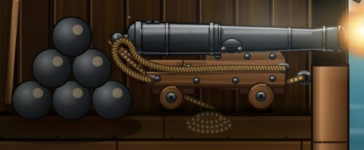
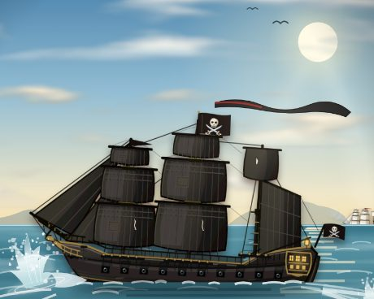
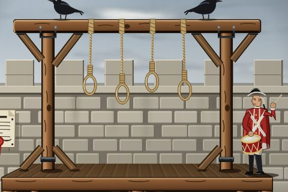
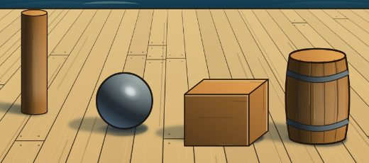
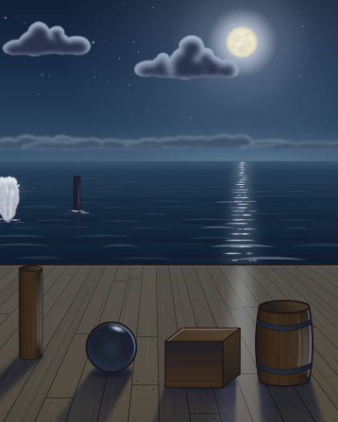
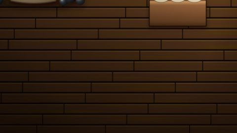
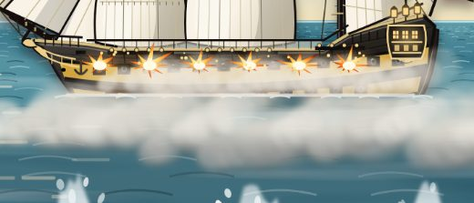
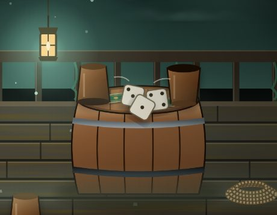

# Библия стиля печатных картинок

Для всех, кто рисует сцены `tools/card-art/scenes/print/*.cjs`. Образцы уровня — шесть карт из `portrait.cjs`
(«Ядра», «Верфь Компании», «Анжелика», «Уйти по ветру», «Сто лет службы», «Игра в кости лжеца») и «Указ о казнях».
Свет, материалы, небо и вода — из библиотеки `tools/card-art/scenes/kit/` (API — `kit/README.md`).

## 1. Что значит «реалистично»

Не фотореализм и не масляная живопись. Это **иллюстрация для настольной игры**: чистые формы, градиенты по форме,
тёплые и холодные пары, глубокие цветные тени. «Реалистично» = **правдоподобно**:
- предмет устроен верно (лафет с осями и колёсами, бочка с клёпками и обручами, парус на рее);
- один согласованный свет на всю сцену, у каждой формы объём;
- материал узнаётся (чугун, дуб, латунь, парусина, вода);
- ничего не висит: всё стоит, лежит, висит на верёвке или в руке.

Проверяющий сравнивает с образцами («лучше / как / хуже»), а не с фотографией.

## 2. Контур

- Ближний и средний план: тонкий **тёмный тёплый** контур 0,4–0,8 ед. (`L.ramp(kind).outline`), как у пушки в «Ядрах».
- Дальний план: контура нет, форма — силуэтом в тоне неба.
- Нельзя: чёрный `#000`, толстый одинаковый контур у всего, контур у дыма, облаков, воды, огня.

## 3. Палитры колод

| Колода | Время (`time`) | Свет | Тень (`shadowTint`) | Небо у горизонта | Акцент |
|---|---|---|---|---|---|
| Чёрная жемчужина | ночь, луна (`night`) | `#b9cff6` | `#1c2346` | `#3d5a74` | сталь, лунное серебро |
| Месть королевы Анны | закат, огонь (`dusk`) | `#ffb070` | `#33264a` | `#ffc070` | красно-рыжий |
| Индевор | день (`day`) | `#fff3d6` | `#2b4262` | `#ecead2` | белое, синее, охра `#c9a048` |
| Летучий голландец | зелёный туман (`fog`) | `#bfe8d6` | `#14302c` | `#4f7566` | бирюза, ракушки |
| Карты моря | серия, палитра `day` | `#fff3d6` | `#2b4262` | `#ecead2` | общий горизонт y = 108 (39 %) |

Готовые схемы — `LIGHTS.pearl | revenge | endeavour | dutchman | sea` в `kit/light.cjs`. Тёплый свет — холодные
тени и наоборот. В тени цвет насыщеннее, чем на свету. Ночью и в тумане цвета приглушены (библиотека делает сама).

## 4. Тон

- Выше линии стекла (верхние 48 % картинки) темнее Y 40 из 255 — **не больше 30 % площади**.
- Тень **никогда не чёрная** и не темнее `#1a1a1a`: это тон опоры в цвете `shadowTint`.
- Самое тёмное и контрастное — ближний план; дальнее уходит к тону неба у горизонта (ночью — не светлее неба,
  в тумане контраст на среднем плане вдвое ниже, дальний почти слился).
- Главный предмет — самое светлое или самое контрастное место открытой части.
- **Печатный профиль** (делает генератор `tools/print/art.ts`, не сцена): набор печатают в типографии на цветном лазере, на
  матовой мелованной бумаге 250–300 г. Тени поднимаются слабо — кривая 0→8, 32→38, 64→68, 128→130, 192→193, 255→255,
  насыщенность +2 % (для домашнего струйника было 0→20 и +5 %). Поэтому тени в сцене рисуй такими, какими хочешь их видеть:
  генератор их почти не осветлит.

## 5. Свет и тени (делает библиотека — не рисуй руками)

1. В файле сцены одна схема `light`; `const L = K.makeLight(light, { horizon })`. Формат — `kit/README.md`.
2. Форма: свет → полутон → **терминатор** → собственная тень → **рефлекс**. `shadeCyl`, `shadeSphere`,
   `shadeBox`, а для своих путей — `mat(kind, L, { form })` и тона `L.ramp(kind)`.
3. **Блик стоит по свету:** на шаре смещён к источнику на 0,3–0,4 радиуса, на цилиндре — полоса на стороне света.
   У всех предметов сцены блики на одной стороне.
4. **Падающая тень — по геометрии** (`castShadow`): солнце и луна — к точке схода на горизонте (`L.vanish`): луна
   за кораблём — тени идут к зрителю и расходятся; свет из-за спины — уходят вглубь и сходятся; боковой — вдоль
   горизонта. Длина = высота × ctg(высота света). Фонарь, свеча, огонь — **веером от точки под источником**.
   Край чёткий у основания, мягче к концу.
5. **Контактная тень** (`contactShadow`) — под всем, что касается опоры.
6. **Локальный свет** (`localGlow`, `light.locals`): тёплый круг с затуханием; внутри радиуса — свои тени и тёплый
   бок у предметов, дальше — только отсвет.
7. **На просвет:** парус против луны светлее, чем в тени; дым, туман и брызги против света светятся.
8. Градиенты `DEFS` из `art.cjs` (`iron`, `oak`, `brass`, `cloth`, `flesh`, `ball`…) и детали с зашитым бликом
   (`ball`, `hand`, `arm`, `bottle`, `cup`, `nails`) в новых сценах запрещены: в них свет всегда сверху-слева.

## 6. Материалы и блики

| Материал (`kind`) | Блик | Рефлекс | Особое |
|---|---|---|---|
| чугун, железо (`iron`) | узкий, белёсо-холодный, резкий | синеватый от неба | ржавчина в углублениях, не по всей площади |
| латунь, золото (`brass`) | узкий, почти белый в тёплом ореоле | тёплый | тёмные впадины гравировки, яркие рёбра |
| дуб, сосна (`oak`, `pine-deck`) | широкий тусклый на рёбрах | тёплый | волокно по доске, светлые потёртости на рёбрах |
| смолёный борт (`tar`) | широкий холодный отлив | синеватый | швы обшивки, не сплошное чёрное |
| парусина, лён (`canvas`, `linen`) | нет | — | **на просвет** светится, швы и рифы темнее |
| кожа-вещь (`leather`), краска (`paint-red`, `paint-ochre`) | широкий тусклый | — | светлые потёртости на рёбрах |
| кожа человека (`skin`) | мягкий на лбу, носу, скуле | тёплый | на просвет — красный край ушей и пальцев |
| кость, коралл, канат (`bone`, `coral`, `rope`) | слабый или нет | тёплый | у каната — свивка |
| стекло, вода (`glass`) | точечный резкий + отражение источника | — | сквозь видно фон, край темнее |
| мокрое (`water-wet`) | яркий, вытянут к зрителю по вертикали | — | отражения предметов размыты |

## 7. Как рисуются среды

- **Вода** (`water`): цвет от неба у горизонта к глубокому у зрителя; ряды зыби сходятся к горизонту, ближе —
  крупнее и контрастнее; дорожка бликов — **под источником**, сужается к горизонту. Отражение (`reflection`) —
  строго вертикально под предметом, размыто, разорвано рябью; светлое отражается темнее, тёмное — светлее. Пена
  (`foam`) — у всего, что касается воды. Корпус обрезан по ватерлинии.
- **Небо** (`sky`, `sunMoon`, `cloud`): градиент к тону горизонта, воздух светлее вокруг источника; облака
  объёмом — свет со стороны источника, тень снизу, плоское дно; дальние — бледнее и мельче.
- **Дерево:** тон по грани, волокно **вдоль** доски, швы, шляпки гвоздей, светлые рёбра к свету.
- **Металл:** резкий переход свет–тень, узкий блик, рефлекс у теневого края, тёмные углубления.
- **Ткань:** складки от точек натяжения (`form: 'fold'` — только ровные), швы полотнищ, блика нет.
- **Огонь** (`fire`): слои — тёмно-красная кайма, рыжее тело, жёлтое ядро, белое сердце, искры; свой свет вокруг.
- **Вспышка выстрела** (`muzzleFlash`): конус вдоль ствола, белое ядро у дула, языки разной длины, дым,
  подсвеченный изнутри. Три формы, не звёзды.
- **Дым** (`smoke`): клубы растут и редеют кверху, тень снизу, свет со стороны источника; по ветру — в одну сторону
  со флагами.
- **Кожа:** тёплый полутон, холодная тень, мягкий блик; лицо крупно — только в ¾ или профиль, наполовину в тени.

## 8. Низ кадра

Из шести образцов берём материалы, свет, цвет, контур и детали, но **не низ**. Ровный дощатый пол во всю ширину
(`ghostDeck`, `plankFloor`, нижняя половина «Ядер» и «Картечи») — **нет**. Низ — 2–4 крупные формы переднего плана
(борт, бухта каната, край стола, волна, бочка в тени) без ровных полос; под стеклом он тёмный и спокойный.
Палуба в перспективе (`deck`) допустима как опора в средней части, когда доски сходятся к горизонту и на ней лежат
тени предметов.

## 9. Фильтры SVG

- **Можно:** `feTurbulence` + `feDisplacementMap` **по краю формы** (дым, облако, огонь, пена, рваный парус;
  смещение ≤ 3 ед.); `feTurbulence` **внутри `clipPath` формы** вдоль волокна (непрозрачность ≤ 0,25, свой `seed`);
  `feGaussianBlur` — мягкий край и пятна света и тени; `multiply` (тень) и `screen` (свет) — внутри группы предмета
  с `isolation: isolate` либо как пятно тени или света от источника (`castShadow`, `localGlow`);
  `feDiffuseLighting` — только тиснение на латуни и коже.
- **Нельзя:** шум или узор прямоугольником на всю картинку, всё море или всю стену; один `seed` у соседей;
  `pattern` как заливка предмета; `<meshgradient>`; растровые картинки в сцене; шум мельче 1,5 ед.
- Смотри рендер в масштабе печати (`--scale 5`, 1000 × 1400): размытие при другом масштабе выглядит иначе.

## 10. Детали

- Фактура по форме, крупнее у зрителя, мельче вдали. Отдельных предметов меньше 6 ед. нет (ноготь, заклёпка,
  шов — часть формы, можно).
- Нет: одинаковых повторов (доски, волны, вспышки), ломаных вместо кривых, плоских заливок без перехода (кроме
  дальних силуэтов), букв, цифр, значков вместо мира.

## 11. Да / нет

| | Пример | Что видно |
|---|---|---|
| да |  | «Ядра»: чугун с холодным бликом, тонкий тёмный контур, дерево с волокном и гвоздями |
| да |  | «Уйти по ветру»: корабль в воде, пена у борта, дальний план бледнее |
| да |  | «Указ о казнях»: толпа силуэтом против света, одна детальная фигура |
| да |  | kit, день: блики на стороне солнца, терминатор и рефлекс, короткие тени в одну сторону |
| да |  | kit, ночь: луна сзади — тени к зрителю и врозь, дорожка бликов под луной, тени цветные |
| да |  | kit: вспышка идёт вдоль ствола, три разные формы, дым светится изнутри |
| нет |  | «Картечь»: ровный дощатый пол на полкартинки, одинаковые доски, предметы без падающих теней |
| нет |  | «Залп всей батареей»: вспышки-звёзды без направления, одинаковые, толстый контур парусов |
| нет |  | «Игра в кости лжеца»: фонарь слева, а бочка освещена сверху и теней от фонаря нет |

Вырезки сделаны скриптом `report/print/agents/kit/crops.mjs` (не в git); стенды библиотеки — там же, `stand-*.png`.
